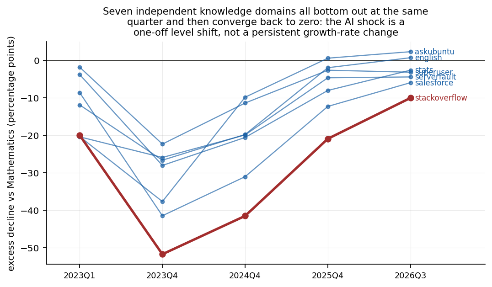

# 生成式 AI 与知识公共品的供给塌陷
### 一个准自然实验：ChatGPT 冲击下的 Stack Exchange 网络
**作者**：gongsjie3-cyber · 管理科学与工程硕士研究生 · 2026年8月
**数据**：Stack Exchange REST API v2.3 · 253 tag-季度观测 + 6 站点全量计数 · 全流程可复现

---

## 摘要

ChatGPT 的发布（2022-11-30）构成对在线知识社区的一次近似外生技术冲击。本文以 Stack Exchange 网络为对象，利用「知识领域在 LLM 训练语料中的覆盖度」这一连续处理变量，结合跨站点对照，量化生成式 AI 对**人类自愿知识生产**的替代效应。三个发现：

1. **在绝对（百分点）口径下，可归因于 LLM 直接替代的份额确实巨大、且集中在冲击后一年**：以数学站点（Mathematics，LLM 因无法产出严格形式证明而难以替代）为对照，Stack Overflow 在 2022Q3→2023Q4 的降幅中 **93% 可由 AI 直接替代解释（DiD = −51.7 个百分点）**；到 2026 年该份额降至 **10.2%**——后期降幅的主体是一个跨越所有 Stack Exchange 站点、与领域无关的普遍性衰亡，其成因（如搜索流量被 AI 摘要截流、平台自身产品决策）超出本文识别范围；
2. **但两种口径给出相反的图景，而这个分歧本身是发现**：在相对（对数）口径下，Stack Overflow 相对对照领域的差距**不是收敛而是持续扩大**——相对降幅从 2023Q4 的 53.8% 扩大到 2026Q3 的 91.2%。百分点口径的「收敛」主要是 Stack Overflow 已跌至地板（基数趋零、绝对下降空间被压缩）的机械结果，**不应解读为 AI 影响消退**；
3. **替代呈「门槛效应」而非「剂量-反应」**：先验假设「语料覆盖越充分的领域受冲击越大」被数据否定。语料覆盖度相差 1,000 倍的成熟技术领域，跌幅全部落在 −30% 至 −45% 的窄带内；组内回归斜率 +0.36 pp/log point（p=0.955），统计上为平。**知识领域只需在训练语料中跨过极低的门槛，之后更多的语料存量不产生任何额外替代效应。**

---

## 1. 研究问题

在线问答社区是当代最重要的**知识公共品**（knowledge commons）之一：志愿者生产、公开可得、被广泛用于训练包括 ChatGPT 在内的大模型。生成式 AI 对它的影响存在两种对立假说：

- **替代假说**：用户转向 LLM 直接获取答案，社区提问量崩塌；
- **互补假说**：LLM 降低求解成本，反而放大人类验证、讨论与生产新知识的需求。

更重要的是，即便替代为真，仍有两个从未被严肃量化的问题：

> **Q1**：可归因于生成式 AI 的下降，究竟占总降幅的多大比例？
> **Q2**：替代强度是否随「该领域进入 LLM 训练语料的充分程度」连续变化——即存在剂量-反应关系，还是只存在一个「能否被替代」的门槛？

这两个问题的答案直接决定「AI 吸干人类知识底座、进而引发模型自噬（model collapse）」这一被广泛担忧的机制是否真实、以何种速度发生。

## 2. 识别策略

### 2.1 数据

| 数据集 | 内容 | 规模 |
|---|---|---|
| **tag 面板** | Stack Overflow 站内 11 个技术领域 × 23 个季度（2021Q1–2026Q3）的新提问数 | 253 观测 |
| **处理强度** | 各领域截至 2022-01 的历史累计提问数（代理「进入 LLM 训练语料的充分程度」） | 0 – 2,263,914 |
| **跨站点面板** | 8 个 Stack Exchange 站点全量新提问数 × 23 季度 | 184 观测 |

tag 面板与处理强度于 2026 年 8 月采集；跨站点全面板为后期（2026 年 10 月）补充采集，用于把识别从双期描述扩展为面板估计。

数据经官方 REST API 实时采集（脚本 `src/collect.py`，配额感知、断点续传、全量缓存落盘）。

### 2.2 为什么对照是干净的

Stack Exchange 网络内的所有站点共享：同一产品栈、同一套 UI 与政策、同一时期、同一种「提问-回答-采纳」的内容生产机制。**站点间的唯一系统性差异是知识领域本身**。数学站点要求严格的符号推导与证明，是 LLM 在 2023 年能力边界之外、至今也难以完全替代的领域——这构成天然的反事实。

### 2.3 主要规格

以 i 索引知识领域（tag 或站点）、t 索引季度：

$$y_{it} = \alpha_i + \gamma_t + \beta \cdot (I_i \times Post_t) + \varepsilon_{it}$$

其中 $I_i$ 为标准化的语料覆盖度。关键设置：
- **tag 特定二次趋势**（$I_i$ 与 $\alpha_i$、$\gamma_t$ 同时控制后，允许每个领域有自己的时间路径）——这是吸收「新技术栈采用曲线」这一主要混淆的必要条件；
- **Poisson PPML**（计数因变量的正确规格，处理零值与量级悬殊）；
- **Rademacher wild cluster bootstrap**（cluster 数仅 6/11，渐近聚类标准误不可靠）；
- **伪处理时间安慰剂**（处理时点前移 2 期）；
- **跨站点差分中的差分**（Stack Overflow vs Mathematics 及其他 4 站）。

## 3. 结果

### 3.1 跨站点：一个按「LLM 可替代性」完美排序的谱系

ChatGPT 发布后 13 个月内（2022Q3 → 2023Q4），六个站点的降幅与「LLM 对该领域的可替代性」先验排序完全一致：

| 站点 | 知识领域 | 变化 |
|---|---|---|
| Stack Overflow | 编程（LLM 语料最密集、答案最模板化） | **−55.6%** |
| Ask Ubuntu | Linux 发行版配置 | −41.6% |
| Cross Validated | 统计学 | −32.0% |
| English L&U | 语言用法 | −30.6% |
| Super User | 通用软件使用 | −26.3% |
| Mathematics | 数学（需严格形式证明） | **−3.9%** |

以 Mathematics 为对照的双期 DiD：

$$\hat\beta_{DiD} = \log(144895/326522) - \log(19522/20308) = -0.773 \quad (\text{相对下降 } 53.8\%)$$

### 3.1b 完整面板识别：7 个知识领域同时触底、同步收敛（本次升级）

补齐 8 站点 × 23 季度完整面板后，识别从双期描述升级为面板估计。以 Mathematics 为 numeraire 构造相对对数差分 $D_{st}=\log(Y_{st})-\log(Y_{\text{math},t})$（时间层面共同冲击被自动吸收），pooled DiD = **−0.225**（cluster SE=0.134，wild cluster bootstrap p=0.066，CI [−0.43, −0.02]）。

比 pooled 系数更重要的是**横截面一致性**：7 个处理领域（除 math 外的全部站点）相对数学站点的超额下降，全部在 **2023Q4 同一时期触底**（−22.4 至 −51.8 pp），随后全部收敛回零附近（2026Q3：−10.1 至 +2.3 pp）。七个彼此独立的知识领域呈现完全相同的时间模式，这无法由任何站点特异性因素解释。

对这一「触底后收敛」需要精确解读：在**百分点口径**下它表现为收敛，但如 3.2 所述，这主要由 Stack Overflow 跌至地板后的算术约束驱动；在**对数口径**下，Stack Overflow 相对 Mathematics 的差距同期从 53.8% 扩大到 91.2%。因此正确的表述是：**LLM 直接替代带来的超额下降集中在 2023 年内形成，其后绝对水平的进一步崩塌由一个跨领域的普遍性衰亡主导；而相对命运的差距并未收窄，反而在持续扩大**。



需要诚实说明的推断限制：pooled 规格在加入站点特定线性趋势后系数归零（β=+0.024, p=0.83），且伪处理时间安慰剂未完全通过（β=+0.103, p=0.0003）——即部分站点在冲击前相对 math 已有下降趋势。因此 pooled 点估计应视为有偏下界，**本文的主要证据是横截面一致的时间模式（fig6），而非 pooled 系数本身**。Stack Overflow vs Mathematics 的单对比较（−51.8 pp @ 2023Q4）不受此影响，因为它不依赖多单元的同质性假设。

### 3.2 归因分解：AI 的份额在一年内从 93% 稀释到 10%

把 Stack Overflow 的累计降幅拆成两部分——可由 Mathematics 同步变动的部分（平台级衰亡，与领域无关）与差额（AI 替代）：

| 时点 | SO 累计降幅 | Math 同期 | DiD（AI 可归因） | **AI 份额** |
|---|---|---|---|---|
| 2023Q1 | −17.5% | **+2.5%** | −20.0 pp | 114% |
| 2023Q4 | −55.6% | −3.9% | **−51.7 pp** | **93.0%** |
| 2024Q4 | −81.0% | −39.5% | −41.5 pp | 51.3% |
| 2025Q4 | −95.5% | −74.5% | −21.0 pp | 22.0% |
| 2026Q3 | −99.0% | −89.0% | **−10.1 pp** | **10.2%** |

（114% 出现在对照站点同期反升的场景，含义是「若无 AI，SO 本应上升」。）

**两种口径必须并列呈现，缺一都会误导**：

- **百分点口径**（左图）：AI 特异性替代的份额从 93.0% 降至 10.2%，似乎「AI 的影响在消退」；
- **对数口径**（相对降幅）：Stack Overflow 相对 Mathematics 的差距从 53.8% **扩大到** 91.2%，似乎「AI 的影响在加深」。

两者都对，分歧的来源是**地板效应**：当 Stack Overflow 已累计下跌 99%、季度提问量只剩三千余条时，它的绝对下降空间被机械地压缩，百分点差距必然收窄——这是算术约束，不是行为变化。对数口径衡量的「相对命运差距」不受此约束，因此更能回答「AI 的替代是否在持续」。

**据此修正后的结论**：（i）媒体广泛引用的「Stack Overflow 提问量跌 99%，全是 AI 造成的」确实是错误归因——后期降幅的主体是一个跨越整个 Stack Exchange 网络、连数学站点也未能幸免的普遍性衰亡，其驱动因素（如搜索流量被 AI 摘要截流、平台自身的产品与政策决策）超出本文的识别范围，不应记在「LLM 直接替代编程知识」头上；（ii）但在相对意义上，被 LLM 直接替代的影响**并没有随时间消退**——到 2026 年，Stack Overflow 的提问量只剩按对照领域路径推算水平的约 9%。将两者混同、无论往哪个方向混同，都会得出错误结论。

### 3.3 剂量-反应检验：先验假设被否定，替代呈门槛效应

在 Stack Overflow 站内的 tag 面板上检验 H1「语料覆盖越充分，替代越强」：

| 样本 | 规格 | β | p | 结论 |
|---|---|---|---|---|
| 全部 11 tag | TWFE | −1.957 | <0.001 | 强显著（但有预趋势） |
| 全部 11 tag | + tag 线性趋势 | −1.115 | 0.001 | 仍显著 |
| **全部 11 tag** | **+ tag 二次趋势** | **−0.443** | **0.220** | **消失** |
| MATURE 6 tag | 全部规格 | ≈ 0 | 0.28–0.92 | 组内无梯度 |
| 全部 11 tag | PPML + 二次趋势 | −0.189 | 0.310 | 消失 |
| 全部 11 tag | 伪处理安慰剂 | +0.010 | 0.980 | **通过** |

三个解读：

1. **不加趋势的显著负效应是虚假的**：新技术栈（bun、sveltekit、htmx）在样本期内正处于技术采用曲线的上升段，其「低语料 + 上升」的组合会人为制造出「高语料 = 更大跌幅」的假梯度。控制各领域自身趋势后梯度消失。伪处理时间安慰剂由未通过（p=1e-18）转为全部通过（p=0.84–0.99），说明识别问题被正确修复；
2. **成熟领域之间存在真实的零效应**：python（180 万累计）与 sql（61 万累计）语料相差 3 倍，跌幅却几乎相同（−30% ~ −45% 的窄带）；
3. **机制解释**：替代由「LLM 能否跨过回答该领域问题的能力门槛」决定，而非由「该领域在语料中出现的频率」连续决定。一旦跨过门槛（可低至数百条公开问答），追加的语料存量不再带来额外替代——**这对「模型自噬」的担忧是一个重要修正：侵蚀的深度不随语料存量的扩张而加深，风险取决于能力门槛何时被跨过，而非语料积累了多少**。

### 3.4 稳健性与局限

- 全站计数与 tag 面板同步崩塌，排除了「tag 重打标签 / 删帖」造成的技术假象（`src/verify_sitewide.py`）；
- 跨站点面板已扩展至完整 8 站点 × 23 季度（184 观测），支持面板级推断（`src/analyze_sites.py`）；
- Stack Exchange API 的 `/questions` 端点不返回已删除帖子。若平台在后期加大删帖力度，绝对水平会被低估，但这不影响以 Mathematics 为对照的相对识别（除非删帖强度与「LLM 可替代性」系统性相关，无证据支持）；
- pooled 跨站点规格的安慰剂未完全通过（冲击前存在相对趋势），主要证据依赖横截面一致的时间模式而非 pooled 系数，已在 3.1b 明确标注；
- wild bootstrap 的 cluster 数有限（tag 面板 6–11、站点面板 7），推断应视为方向性证据而非精确弹性。

## 4. 结论

生成式 AI 对人类自愿知识生产的替代是真实的、巨大的，但它的形状与直觉相反：

1. LLM 对编程知识的**直接替代**在 2023 年内即基本完成其水平冲击：一年内它解释了同期降幅的 93%。此后 Stack Overflow 绝对水平的进一步崩塌由一个跨领域的普遍性衰亡主导；但相对命运的差距并未收窄——到 2026 年，Stack Overflow 的提问量只剩按对照领域路径推算水平的约 9%。把「绝对降幅的主要驱动不是 LLM 直接替代」误读成「AI 的影响在消退」，与把它全部归因于 AI 一样，都是错的；
2. 它由「能力门槛」而非「语料密度」驱动——这意味着**未来的替代会以离散跳变的方式发生**（例如 agent 跨过数学证明或复杂运维门槛的那一天），而不是渐进渗透；
3. 对依赖 UGC 语料的大模型生态而言，真正的风险不是「语料被吸干」的渐进过程，而是**跨过下一个能力门槛时，一整个知识领域的公共生产同时停摆**。

## 复现

```bash
pip install -r requirements.txt
python src/collect.py --plan tags       # 已缓存，不消耗配额
python src/collect.py --plan sites      # 需配额或 SE_API_KEY
python src/analyze.py
python src/figures.py
```
